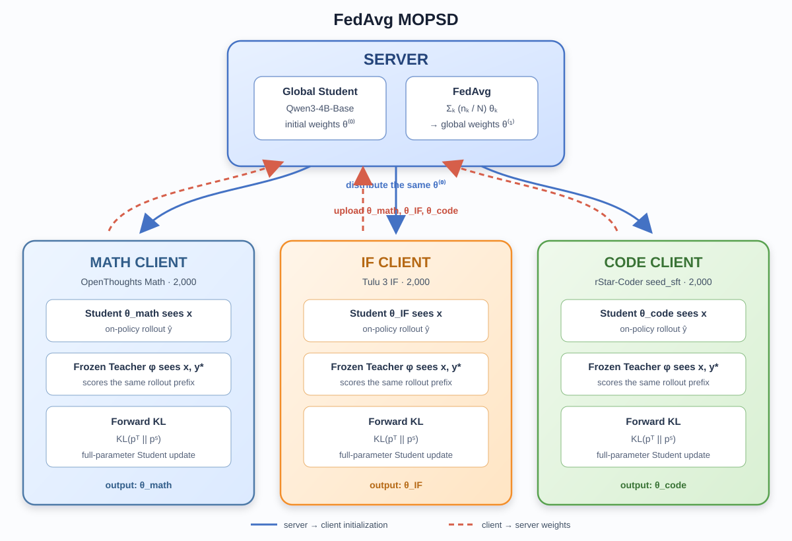
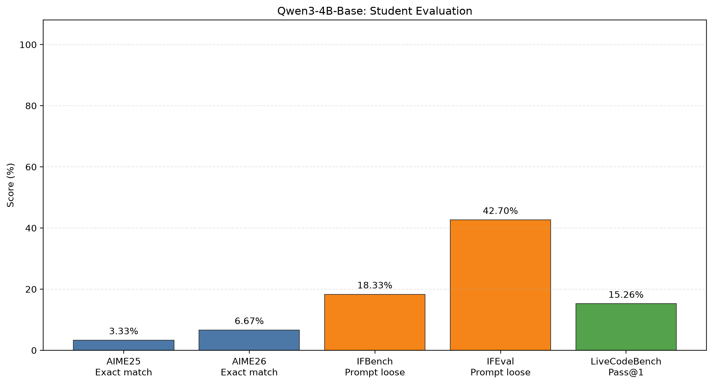
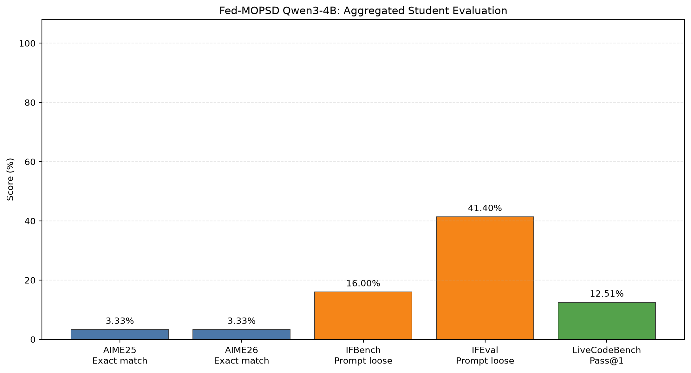
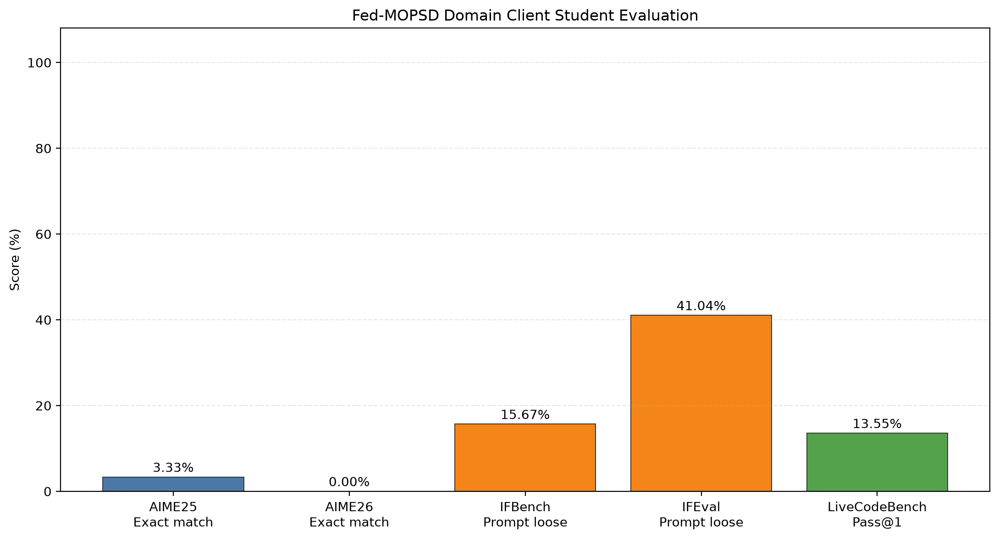
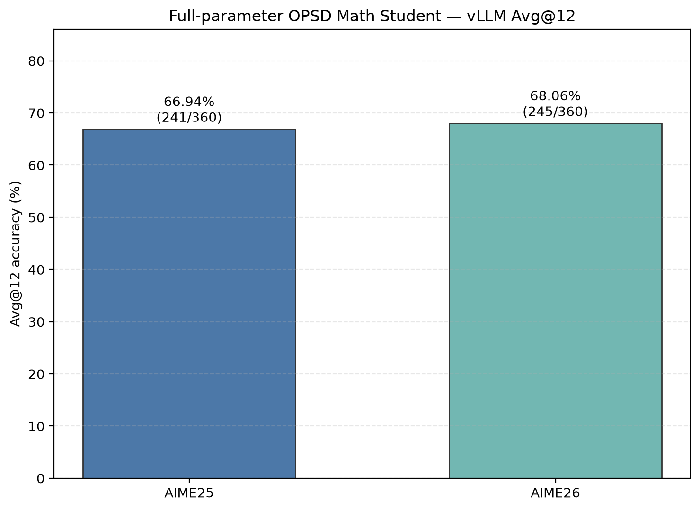

# FedAvg-MOPSD：面向多领域大语言模型的联邦在线策略自蒸馏

本项目探索如何将 On-Policy Self-Distillation（OPSD）与 Federated Averaging（FedAvg）结合，使一个全局模型在不集中 Math、Instruction Following（IF）和 Code 三个领域原始训练数据的前提下进行多领域学习。

实验以 `Qwen3-4B-Base` 为初始全局模型。三个 Client 分别在自己的领域执行全参数 OPSD，再由 Server 对三个本地 Student 的完整模型参数做等权平均。由于第一次 FedAvg-MOPSD 实验在多数 benchmark 上出现退化，本项目随后依次评测了各领域 Client Student，并按照 OPSD 原文的模型与设置重新进行了一个独立的 Math Client 实验。

仓库仅包含实验代码、配置和评测结果，不包含模型权重、优化器状态或 checkpoint。

## 仓库结构

```text
.
├── code/
│   ├── 1.eval_student.ipynb
│   ├── FedAvg_mopsd.ipynb
│   ├── eval_client_students.ipynb
│   ├── eval_client_students_vllm.ipynb
│   ├── client_math.ipynb
│   ├── client_math_eval.ipynb
│   ├── client_math_eval_vllm.ipynb
│   └── download_*.ipynb
├── img/
│   └── fedavg_mopsd_architecture.svg
└── results/
    ├── student_qwen3_4b_base_eval/
    ├── fed_mopsd_qwen3_4b_base/
    │   ├── evaluation/
    │   ├── client_student_evaluation/
    │   └── client_math_opsd_qwen3_4b_fullft/
    └── client_student_evaluation_vllm_38912/
```

## 方法：FedAvg-MOPSD



Server 保存第 0 轮全局参数 $\theta^{(0)}$。Math、IF 和 Code Client 的 Student 均从同一个 checkpoint 初始化：

$$
\theta_{\mathrm{math}}^{(0)}
=\theta_{\mathrm{if}}^{(0)}
=\theta_{\mathrm{code}}^{(0)}
=\theta^{(0)}.
$$

每个 Client 同时保留一个冻结 Teacher，Teacher 的初始参数为 $\phi=\theta^{(0)}$，训练过程中不更新。对于本地样本 $(x,y^*)$：

- Student 只能看到问题或指令 $x$；
- Teacher 可以额外看到参考答案 $y^*$；
- Student 根据当前策略生成 on-policy rollout $\hat y$；
- Student 和 Teacher 在同一个 Student rollout 前缀上给出下一 token 分布。

Student 的第 $t$ 个 token 按下式采样：

$$
\hat y_t \sim p_{\theta_k}\!\left(\cdot \mid x,\hat y_{1:t-1}\right).
$$

Student 与 Teacher 的分布分别为：

$$
p_t^S=p_{\theta_k}\!\left(\cdot \mid x,\hat y_{1:t-1}\right),
\qquad
p_t^T=p_{\phi}\!\left(\cdot \mid x,y^*,\hat y_{1:t-1}\right).
$$

原始 FedAvg-MOPSD 实验在完整词表上计算 Teacher 到 Student 的 forward KL：

$$
\mathcal L_k
=\frac{1}{T}\sum_{t=1}^{T}
D_{\mathrm{KL}}\!\left(p_t^T\,\|\,p_t^S\right).
$$

其中

$$
D_{\mathrm{KL}}(p^T\|p^S)
=\sum_{v\in\mathcal V}p^T(v)
\log\frac{p^T(v)}{p^S(v)}.
$$

训练结束后，三个 Client 只上传本地 Student 权重。Server 采用等权 FedAvg：

$$
\theta^{(1)}
=\frac{1}{3}\left(
\theta_{\mathrm{math}}^{(1)}
+\theta_{\mathrm{if}}^{(1)}
+\theta_{\mathrm{code}}^{(1)}
\right).
$$


## 数据集

### 训练集

| Client | 数据集 | Split / Config | 实际使用 | 用途 |
|---|---|---|---:|---|
| Math | [`siyanzhao/Openthoughts_math_30k_opsd`](https://huggingface.co/datasets/siyanzhao/Openthoughts_math_30k_opsd) | `train` | FedAvg 实验 2,000；独立 OPSD 实验 1,600 | 数学问题与参考解答 |
| IF | [`allenai/tulu-3-sft-personas-instruction-following`](https://huggingface.co/datasets/allenai/tulu-3-sft-personas-instruction-following) | `train` | 2,000 | 指令与目标回复 |
| Code | [`microsoft/rStar-Coder`](https://huggingface.co/datasets/microsoft/rStar-Coder) | `seed_sft/train` | 2,000 | 仅保留 `verified=True` 且 `is_passed=True` 的样本 |

三个领域的数据是 Non-IID的，每个 Client 仅访问自己的本地训练数据。

### 测试集

| 领域 | Benchmark | 样本数 | 主要指标 |
|---|---|---:|---|
| Math | [`math-ai/aime25`](https://huggingface.co/datasets/math-ai/aime25) | 30 | Exact Match / Avg@12 |
| Math | [`math-ai/aime26`](https://huggingface.co/datasets/math-ai/aime26) | 30 | Exact Match / Avg@12 |
| IF | [`allenai/IFBench_test`](https://huggingface.co/datasets/allenai/IFBench_test) | 300 prompts / 344 instructions | Prompt/Instruction Strict & Loose |
| IF | [`google/IFEval`](https://huggingface.co/datasets/google/IFEval) | 541 prompts / 834 instructions | Prompt/Instruction Strict & Loose |
| Code | [`livecodebench/code_generation_lite`](https://huggingface.co/datasets/livecodebench/code_generation_lite) | 1,055 | Pass@1 |

LiveCodeBench 使用 `release_v6` 和固定 revision 的官方 runner。

## 实验路线与结果

实验顺序：

```text
Qwen3-4B-Base（训练前 Student）
  → 三个 Client 独立 OPSD + FedAvg 参数平均
  → 评测聚合后的 FedAvg Student
  → 分别评测 Math / IF / Code Client Student
  → 按 OPSD 原文设置重新训练并评测独立 Math Client
```

### 1. Qwen3-4B-Base：训练前 Student



| Benchmark | 指标 | 正确数 / 总数 | 得分 |
|---|---|---:|---:|
| AIME25 | Exact Match | 1 / 30 | 3.33% |
| AIME26 | Exact Match | 2 / 30 | 6.67% |
| IFBench | Prompt-level Loose | 55 / 300 | 18.33% |
| IFEval | Prompt-level Loose | 231 / 541 | 42.70% |
| LiveCodeBench | Pass@1 | 161 / 1,055 | 15.26% |


baseline的 `max_new_tokens` 设置为 2,048；

### 2. FedAvg-MOPSD 聚合 Student

三个client各自维护2个模型，单个模型的显存占用大概8~9GB。所以我一次只进行一个client的OPSD，但是
max_new_token开太大了还是会OOM，所以就把max_new_token设置为了1024。

三个 Client 完成本地 OPSD 后，Server 对三个完整 checkpoint 做等权平均。聚合模型实验结果统计：



| Benchmark | 训练前 Base | FedAvg Student | 绝对变化 |
|---|---:|---:|---:|
| AIME25 Exact Match | 3.33% | 3.33% | 0.00 pp |
| AIME26 Exact Match | 6.67% | 3.33% | -3.34 pp |
| IFBench Prompt Loose | 18.33% | 16.00% | -2.33 pp |
| IFEval Prompt Loose | 42.70% | 41.40% | -1.30 pp |
| LiveCodeBench Pass@1 | 15.26% | 12.51% | -2.75 pp |

除 AIME25 持平外，其余主要指标均下降。

但 baseline 与 FedAvg Student 的生成长度不同，所以不能完全说明这次的 FedAvg-MOPSD失效了；

### 3. 单独测评 Client Student

max_new_token还是设置为1,024

为了判断退化来自 Server 聚合，还是已经发生在 Client 本地训练阶段，我对每个 Client 对应领域进行评测：

- Math Client：AIME25、AIME26；
- IF Client：IFBench、IFEval；
- Code Client：LiveCodeBench。



| 对应领域 Benchmark | 训练前 Base | 对应 Client Student | 绝对变化 |
|---|---:|---:|---:|
| AIME25 Exact Match | 3.33% | 3.33% | 0.00 pp |
| AIME26 Exact Match | 6.67% | 0.00% | -6.67 pp |
| IFBench Prompt Loose | 18.33% | 15.67% | -2.66 pp |
| IFEval Prompt Loose | 42.70% | 41.04% | -1.66 pp |
| LiveCodeBench Pass@1 | 15.26% | 13.55% | -1.71 pp |

各 Client 在自己的领域上也没有提升，说明问题并不只来自 FedAvg 参数平均；client上的 OPSD 阶段本身就可能出现了能力退化。

### 4. 按 OPSD 设置重新训练独立 Math Client

为了进一步定位本地 OPSD 失效原因，我按照OPSD原文的设置先在math任务上测试。主要设置为：

| 项目 | 配置 |
|---|---|
| 初始模型 | `Qwen/Qwen3-4B` |
| 微调方式 | 全参数微调，不使用 LoRA 或量化 |
| 实际训练步数 | 50 optimizer steps |
| 训练样本数 | 1,600 |
| batch size | 32 |
| Optimizer | AdamW fused |
| 学习率 | $5\times10^{-6}$，linear schedule |
| Student | Thinking OFF，只看问题 |
| Teacher | Thinking ON，可见参考解答，参数冻结 |
| KL 方向 | Forward KL，$D_{\mathrm{KL}}(p_T\|p_S)$ |
| 逐元素截断 | 每个 token-vocabulary KL contribution 上限 0.05（原文方法） |
| 训练 rollout 上限 | 1,024 tokens |
| 测评 | Thinking ON，Avg@12，最多 38,912 new tokens |

max_new_token设置很大，为了能够把实验跑下来，这里使用的是单张 RTX 4090 48GB。
显存占用峰值大概是35GB



| Benchmark | Avg@12 | 正确生成 / 总生成 | Pass@12 | 格式正确率 |
|---|---:|---:|---:|---:|
| AIME25 | 66.94% | 241 / 360 | 86.67% | 97.22% |
| AIME26 | 68.06% | 245 / 360 | 86.67% | 98.61% |

Avg@12 表示每道题独立生成 12 次，最后对全部 $30\times12=360$ 次生成的正确率取平均；它不同于“12 次中只要答对一次就算通过”的 Pass@12。

实验指标接近OPSD原文，说明选择 Qwen3-4B 模型和长 Thinking 评测对结果影响比较大。


## 后续方案：从权重平均转向联邦蒸馏

当前实验使用最直接的 FedAvg：各 Client 完成本地 OPSD 后上传完整 Student 权重，Server 对参数逐元素平均。但是 Math、IF、Code 数据本身就是 Non-IID的，三个本地模型可能沿不同方向漂移，直接平均可能得不到好的结果。

下面假设有三个 Client。每轮开始时，Server 向三个 Client 下发同一份全局 Student 权重。每个 Client 将该权重复制一份并冻结为本地 Teacher；Student 只看到问题，Teacher 额外看到本地答案等特权信息，然后执行 OPSD。

### 方案一：FedAvg 完整权重聚合（之前的方案）

流程如下：

1. Server 下发全局权重；
2. 三个 Client 分别维护一个可训练 Student 和一个冻结 Teacher；
3. 本地 OPSD 完成后，各 Client 上传完整 Student 权重或参数增量；
4. Server 对三个 Client 的参数做加权平均，产生下一轮全局模型。

优点是实现简单、无需对齐不同 Client 的 token 分布，并且 Server 不需要参与反向传播。缺点是完整模型通信量大，而且 Non-IID 条件下的直接权重平均可能抵消有用更新或破坏已有能力。

对于 4B 模型，BF16 权重本身约为 8 GB。三个 Client 每轮上传完整权重时，单轮上行通信约为 $3\times8=24$ GB

### 方案二：并行 Client 的 top-k 联邦蒸馏

Server 额外维护一个可训练 Student。三个 Client 完成本轮本地 OPSD 后，不上传完整权重，而是在一组共同输入和共同生成前缀上返回每个位置的 top-k token ID 与概率或 logit。Server 聚合这三个稀疏分布，把聚合结果作为 Teacher 更新自己的 Student。

在位置 $t$，Client $i$ 返回稀疏分布 $q_{i,t}$。令三个 top-k 支持集合的并集为

$$
S_t=\bigcup_i \mathrm{TopK}\!\left(q_{i,t}\right).
$$

Server 可在并集上进行加权概率聚合：

$$
\bar q_t(v)=\sum_i w_i q_{i,t}(v),\qquad v\in S_t,
$$

然后对 $\bar q_t$ 重新归一化，并最小化

$$
\mathcal L_{\mathrm{server}}
=\frac{1}{T}\sum_t
D_{\mathrm{KL}}\!\left(\bar q_t\,\|\,p_{\theta_s,t}\right).
$$


### 方案三：Client 轮流进行 Server Student

Server 同样维护一个可训练 Student，但 Client 按

```text
Math → IF → Code → Math → ...
```

依次参与。任一时刻只有一个 Client 使用共同输入和 Server 当前 rollout 计算 top-k 分布并返回，Server 随即完成一次或若干次蒸馏更新，再进入下一个 Client。

该方案适合单机或 GPU 数量有限的环境：分布式运行时，活跃模型只有一个 Client 的 Student + Teacher，以及一个 Server Student；如果在同一张 GPU 上分阶段执行，并在 Client 推理与 Server 反向传播之间卸载模型，峰值可以控制在约两份模型权重加当前训练状态，而不必同时驻留七份模型。

主要风险是顺序偏置和灾难性遗忘。Server 刚从 Math Client 学到的能力可能被随后的 IF、Code 更新覆盖。建议同时采用：

1. 每轮随机打乱 Client 顺序，而不是长期固定为 Math → IF → Code；
2. 在每次 Client 更新中混入共享 replay/anchor prompts；
3. 对 Server 更新加入相对上一轮全局模型的 KL anchor 或 FedProx 正则；
4. 使用较小学习率、EMA Server 或周期性多 Client 汇总，降低单个 Client 对 Server 的瞬时影响。

**但是方案二和方案三都有一个问题：可能会打破联邦学习数据私有的要求。server得到教师分布过后，server还要同时拿到问题prompt进行rollout。client提供问题prompt如果算作私有数据泄露那就不可行**


### 大模型对方案二和方案三的分析：

不能简单地把三个 top-k 列表拼接后再次取 top-k，因为不同 Client 的支持集合不同，直接截断会丢失尾部概率质量并引入系统性偏差。更稳妥的实现应同时上传 top-k 概率和剩余 tail mass，或在固定候选集合上进行稀疏聚合。

该方案的通信量与 token 数、样本数和 $k$ 成正比，而不再与模型参数量直接成正比。若每个 token 上传一个 32-bit token ID 和一个 FP16 概率，则每个位置约需要 $6k$ bytes。以 $k=20$、序列长度 1,024 为例，每条样本约为 120 KB；2,000 条样本约为 240 MB/Client/轮，明显低于上传 8 GB 完整权重，但长 Thinking 序列会线性增加开销。

显存方面，全系统逻辑上仍保存 $1+3\times2=7$ 份模型权重：Server Student 一份，每个 Client 各有 Student 和 Teacher 两份。但联邦环境中这些模型分布在四个节点上，并不需要放在同一张 GPU：

- 每个 Client GPU 只承担本地 Student + Teacher；
- Server GPU 只承担 Server Student 及其梯度、优化器和激活；
- 只有在单机上强行并行模拟所有节点时，才会出现至少约 $7\times8=56$ GB 的纯权重占用，训练状态和激活还会进一步增加，单张 48 GB GPU 无法同时容纳。

####  隐私边界：top-k 不等于无泄漏

联邦学习只保证原始数据不被直接集中，并不自动提供严格隐私。完整权重、梯度、参数增量和 top-k logits 都可能泄露训练数据特征。尤其是，如果 Client 将私有问题、私有答案、Student rollout 或与其逐 token 对齐的 top-k 一并发送给 Server，Server 仍有可能恢复私有语义。

更合适的协议是使用公共代理数据（public proxy/anchor set）：

1. Server 向所有 Client 广播同一批公开或合成 prompts；
2. Server 生成共同 rollout，或规定所有 Client 使用同一个 token 前缀；
3. Client 使用本地训练后的模型对这些公共前缀评分；
4. Client 只上传稀疏 top-k 分布；
5. 通过 Secure Aggregation 聚合后，Server 只看到汇总分布；
6. 必要时再加入 client-level clipping 与差分隐私噪声。

公共输入和共同前缀非常重要：没有相同上下文，不同 Client 在同一位置返回的 top-k 分布没有可比性，Server 也无法定义正确的逐 token KL。
