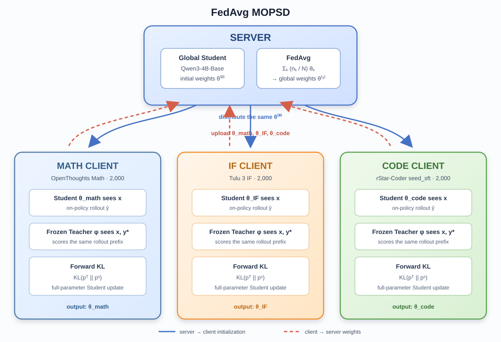
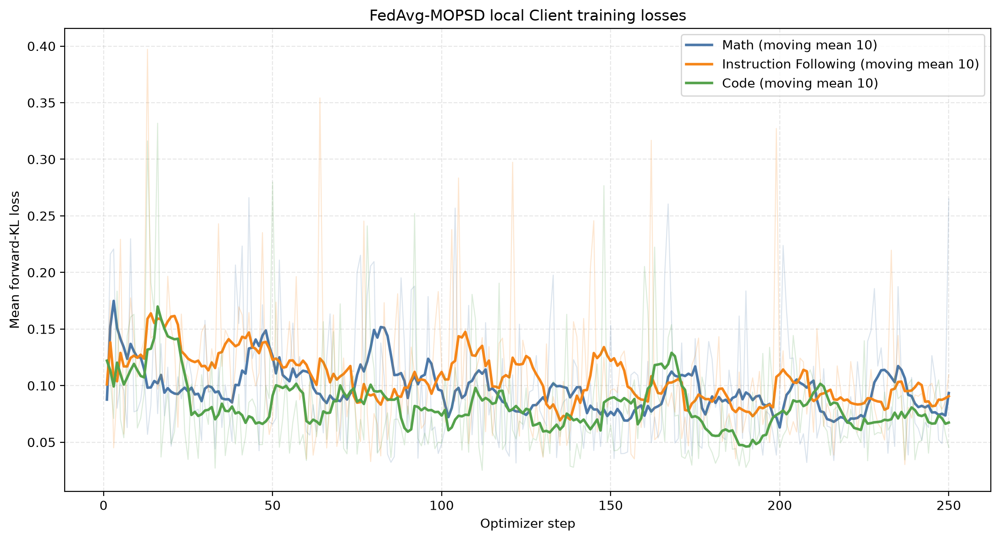
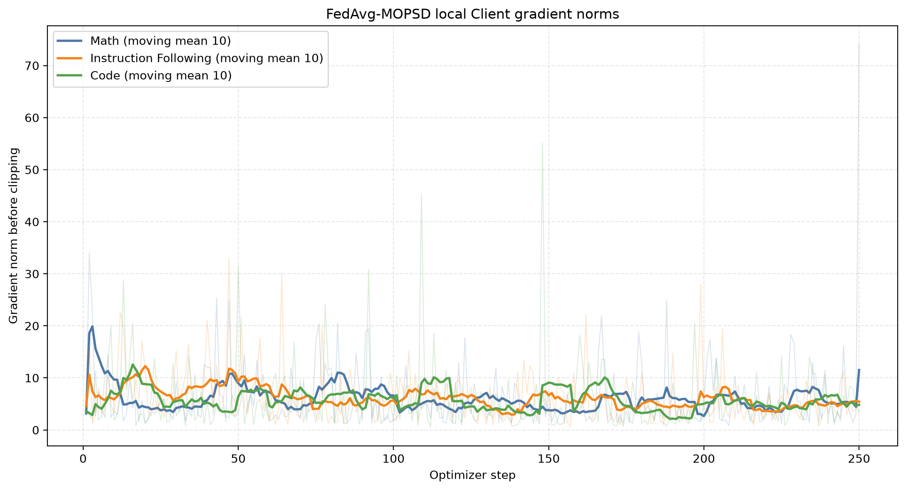
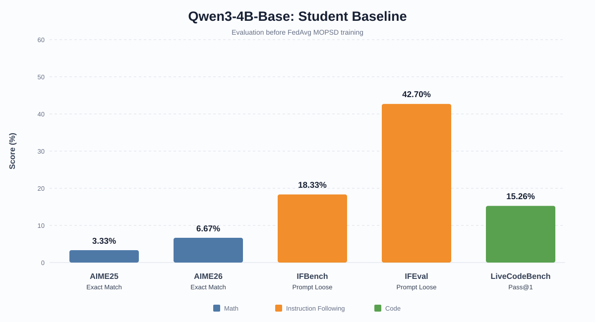

# FedAvg MOPSD：面向多领域大语言模型的联邦在线策略自蒸馏

探索如何将 **On-Policy Self-Distillation（OPSD）** 与 **Federated Averaging（FedAvg）** 结合，在不集中三个领域原始训练数据的前提下，使一个 `Qwen3-4B-Base` 全局模型同时学习数学、指令遵循和代码能力。

当前仓库包含：

- `code/1.eval_student.ipynb`：评测未经训练的 `Qwen3-4B-Base`；
- `code/FedAvg_mopsd.ipynb`：三个 Client 的 OPSD 全参数训练、断点恢复、模型保存、FedAvg 聚合及聚合模型评测；
- `img/`：实验架构图、基线结果图及训练曲线；
- `results/student_base_metrics.csv`：当前已经完成的基础模型评测结果。

> 当前进度：三个 Client 的本地 OPSD 训练与 FedAvg 聚合已经完成，聚合模型的完整 benchmark 评测仍在进行。因此，本 README 暂时只报告训练前 Student 的基线结果，后续将补充各领域 Client Student 与 FedAvg Student 的对比。

## FedAvg MOPSD

### 总体框架

系统包含一个 Server 和三个具有不同领域数据的 Client：

- **Math Client**：数学推理数据；
- **IF Client**：Instruction Following 数据；
- **Code Client**：代码生成数据。

Server 保存初始全局模型参数 $\theta^{(0)}$。三个 Client 的 Student 都从同一份 `Qwen3-4B-Base` 参数开始，而不是从前一个 Client 训练后的模型继续训练：

$$
\theta_{\mathrm{math}}^{(0)}
=\theta_{\mathrm{if}}^{(0)}
=\theta_{\mathrm{code}}^{(0)}
=\theta^{(0)}.
$$

每个 Client 同时保留一个冻结的 Teacher。Teacher 与 Student 最初来自相同 checkpoint，Teacher 参数记为 $\phi=\theta^{(0)}$，在训练过程中不更新。三个 Client 独立完成 OPSD 后，只向 Server 上传训练后的本地 Student 权重；原始问题、参考答案和本地梯度不上传。Server 最后通过 FedAvg 得到一个全局 Student。

当前代码在一张 GPU 上按照 `Math → IF → Code` 顺序串行模拟三个 Client，以控制显存占用。每个 Client 完成后保存模型并释放显存。尽管物理执行是串行的，三个本地 Student 在逻辑上相互独立，均从同一份初始全局参数开始。

### Client 上的 On-Policy Self-Distillation

对于 Client $k$ 的一条本地数据 $(x,y^*)\in D_k$：

- $x$ 是问题或用户指令；
- $y^*$ 是经过验证的参考答案；
- Student 只能看到 $x$；
- Teacher 可以看到 $x$ 和特权信息 $y^*$。

#### 1. Student 生成 on-policy rollout

Student 根据自己的当前策略自回归采样回复 $\hat y=(\hat y_1,\ldots,\hat y_T)$：

$$
\hat y_t\sim p_{\theta_k}
\left(\cdot\mid x,\hat y_{<t}\right).
$$

这里使用 Student 自己生成的序列，而不是直接在参考答案 $y^*$ 上做普通 SFT，因此训练数据始终来自当前 Student 的状态分布，这就是 **on-policy**。

#### 2. Teacher 在相同 rollout 前缀上提供分布

在每个时间步 $t$，Student 与 Teacher 都以 Student 已生成的相同前缀 $\hat y_{<t}$ 为条件。二者的区别是 Teacher 额外看到参考答案 $y^*$：

$$
p_t^{S}=p_{\theta_k}
\left(\cdot\mid x,\hat y_{<t}\right),
$$

$$
p_t^{T}=p_{\phi}
\left(\cdot\mid x,y^*,\hat y_{<t}\right).
$$

因此，即使 Student 的前缀已经出现错误，Teacher 仍可利用 $y^*$ 判断下一步 token 应更倾向于哪些方向。Teacher 只执行前向传播，不接收梯度。

#### 3. 计算全词表前向 KL

温度为 $\tau$ 时，代码在每个 rollout token 上计算 Teacher 到 Student 的前向 KL，并在序列长度上取平均：

$$
\mathcal L_k(x,y^*)
=\frac{\tau^2}{T}
\sum_{t=1}^{T}
D_{\mathrm{KL}}
\left(
p_{t,\tau}^{T}\;\|\;p_{t,\tau}^{S}
\right),
$$

其中

$$
D_{\mathrm{KL}}(p^T\|p^S)
=\sum_{v\in\mathcal V}
p^T(v)\log\frac{p^T(v)}{p^S(v)}.
$$

KL 在完整词表 $\mathcal V$ 上计算，不是只比较被采样 token 的概率。实现中按 token 分块计算，以降低峰值显存。反向传播只经过 Student logits；其梯度形式为

$$
\frac{\partial\mathcal L_k}{\partial z_t^S}
=\frac{\tau}{T}\left(p_{t,\tau}^{S}-p_{t,\tau}^{T}\right),
$$

随后通过 Student 网络更新本地全部参数：

$$
\theta_k\leftarrow
\theta_k-\eta_k\nabla_{\theta_k}\mathcal L_k.
$$

### Server 上的 FedAvg

本轮本地训练完成后，三个 Client 分别得到
$\theta_{\mathrm{math}}^{(1)}$、$\theta_{\mathrm{if}}^{(1)}$ 和
$\theta_{\mathrm{code}}^{(1)}$。Server 按 Client 的有效样本量聚合：

$$
\theta^{(1)}
=\sum_{k\in\{\mathrm{math,if,code}\}}
\frac{n_k}{\sum_j n_j}\theta_k^{(1)}.
$$

本实验中三个 Client 都使用 $n_k=2000$ 条样本，所以样本加权 FedAvg 与等权平均相同：

$$
\theta^{(1)}
=\frac{1}{3}
\left(
\theta_{\mathrm{math}}^{(1)}+
\theta_{\mathrm{if}}^{(1)}+
\theta_{\mathrm{code}}^{(1)}
\right).
$$

聚合的是完整模型参数，而不是三个 Client 的 loss、梯度或 token logits。每个本地 Student 也单独保存，用于后续比较“领域专用本地模型”和“多领域聚合模型”。

### 当前实验配置

| 项目 | 配置 |
|---|---|
| 初始模型 | [`Qwen/Qwen3-4B-Base`](https://huggingface.co/Qwen/Qwen3-4B-Base) |
| Teacher | 与初始 Student 相同 checkpoint，冻结参数，可见 $y^*$ |
| Student | 每个 Client 独立初始化，全参数训练，不使用 LoRA，不使用 4-bit 量化 |
| 联邦轮数 | 1 |
| 每个 Client 的实际训练样本 | 2,000 |
| Local epoch | 1 |
| Rollout 数量 | 每个 prompt 1 条 |
| Micro batch size | 1 |
| 梯度累计 | 8，等效每个 optimizer step 使用 8 条 rollout |
| Optimizer | Adafactor，cosine schedule，warmup ratio 0.03 |
| 学习率 | Math: $1\times10^{-6}$；IF: $5\times10^{-6}$；Code: $5\times10^{-6}$ |
| 最大生成长度 | 1,024 tokens |
| 最大训练序列长度 | 4,096 tokens |
| 蒸馏温度 | $\tau=1$ |
| KL 方向 | Forward KL：$D_{\mathrm{KL}}(p^T\|p^S)$ |
| 梯度裁剪 | 1.0 |
| 随机种子 | 42 |
| Checkpoint | 每50个 optimizer steps 保存，始终只保留最新一个 |

> 隐私边界：该设计避免上传原始 Client 数据和参考答案，但普通 FedAvg 上传完整模型参数，本身不构成严格的差分隐私保证。若需要更强隐私保护，还需加入安全聚合、差分隐私或其他专门机制。当前实验是在单机单卡上对联邦流程的模拟实现。

### 本地训练轨迹

每个 Client 共执行250个 optimizer steps。下图中的浅色线是逐步记录，深色线是窗口为10的移动平均；梯度范数记录的是执行 `max_grad_norm=1.0` 裁剪前的值。由于 Student rollout 会随当前策略变化，OPSD 的训练样本分布也在持续变化，因此 step loss 不要求像固定监督数据上的普通 SFT 一样单调下降。

## 数据集

### 训练集

每个数据源先准备3,000条规范化本地记录，本次实际训练读取其中前2,000条。每条记录都包含问题 $x$ 与可作为 OPSD 特权信息的参考答案 $y^*$。

| Client | 数据集与来源 | Split / Config | 本次使用 | 说明 |
|---|---|---|---:|---|
| Math | [`siyanzhao/Openthoughts_math_30k_opsd`](https://huggingface.co/datasets/siyanzhao/Openthoughts_math_30k_opsd) | `train` | 2,000 | 数学推理问题及参考解答；过滤显式标记为错误的记录 |
| IF | [`allenai/tulu-3-sft-personas-instruction-following`](https://huggingface.co/datasets/allenai/tulu-3-sft-personas-instruction-following) | `train` | 2,000 | 带目标回复的指令遵循数据，目标回复作为 $y^*$ |
| Code | [`microsoft/rStar-Coder`](https://huggingface.co/datasets/microsoft/rStar-Coder) | `seed_sft` / `train` | 2,000 | 仅保留 `verified=True` 且 `is_passed=True` 的可验证代码样本 |

三个领域的数据呈明显 Non-IID 分布：每个 Client 只访问自己的领域数据，不交换原始样本。

### 测试集

| 领域 | Benchmark 与来源 | 使用的 split / release | 样本数 | 指标 |
|---|---|---|---:|---|
| Math | [`math-ai/aime25`](https://huggingface.co/datasets/math-ai/aime25) | `test` | 30 | Exact Match |
| Math | [`math-ai/aime26`](https://huggingface.co/datasets/math-ai/aime26) | `test` | 30 | Exact Match |
| IF | [`allenai/IFBench_test`](https://huggingface.co/datasets/allenai/IFBench_test) | 唯一评测 split 在数据集中命名为 `train` | 300 prompts / 344 instructions | Prompt/Instruction-level Strict & Loose Accuracy |
| IF | [`google/IFEval`](https://huggingface.co/datasets/google/IFEval) | 唯一评测 split 在数据集中命名为 `train` | 541 prompts / 834 instructions | Prompt/Instruction-level Strict & Loose Accuracy |
| Code | [`livecodebench/code_generation_lite`](https://huggingface.co/datasets/livecodebench/code_generation_lite) / [official runner](https://github.com/LiveCodeBench/LiveCodeBench) | `release_v6`, `test` | 1,055 | Pass@1 |

LiveCodeBench 使用固定的 `release_v6` Parquet 分片和固定版本的官方 runner，以避免数据或评测逻辑随上游更新而漂移。

## 评测结果

### Qwen3-4B-Base：训练前 Student

下图展示每个 benchmark 的一个主要指标。IFBench 与 IFEval 在图中采用 **prompt-level loose accuracy**；全部 strict/loose 指标见后续表格。

基线评测覆盖各 benchmark 的完整样本，随机种子为42，`max_new_tokens=2048`，采样参数为 `temperature=0.6`、`top_p=0.95`、`top_k=20`。后续本地 Student 与 FedAvg Student 将沿用同一套评测流程；若生成参数发生变化，将单独注明，避免不可比结果。

| Benchmark | 指标 | 正确数 / 总数 | 得分 |
|---|---|---:|---:|
| AIME25 | Exact Match | 1 / 30 | **3.33%** |
| AIME26 | Exact Match | 2 / 30 | **6.67%** |
| IFBench | Prompt-level Loose | 55 / 300 | **18.33%** |
| IFEval | Prompt-level Loose | 231 / 541 | **42.70%** |
| LiveCodeBench | Pass@1 | 161 / 1,055 | **15.26%** |

IF benchmark 的完整结果如下：

| Benchmark | Prompt Strict | Instruction Strict | Prompt Loose | Instruction Loose |
|---|---:|---:|---:|---:|
| IFBench | 14.67% (44/300) | 16.86% (58/344) | 18.33% (55/300) | 21.22% (73/344) |
| IFEval | 39.19% (212/541) | 51.08% (426/834) | 42.70% (231/541) | 54.56% (455/834) |

这些结果构成后续对比的统一 baseline。待 FedAvg MOPSD 评测完成后，将在相同生成配置和相同 benchmark 上补充：

1. Math / IF / Code 三个本地 Student 在本领域与跨领域 benchmark 上的结果；
2. FedAvg 聚合 Student 的完整结果；
3. 相对 `Qwen3-4B-Base` baseline 的绝对提升与相对提升；
4. 本地领域能力与聚合后多领域能力之间的权衡；
5. 必要的消融实验，例如无特权答案、不同 KL 方向、不同 Client 权重和不同本地训练步数。

当前完整数值同时保存在 [`results/student_base_metrics.csv`](results/student_base_metrics.csv)。
